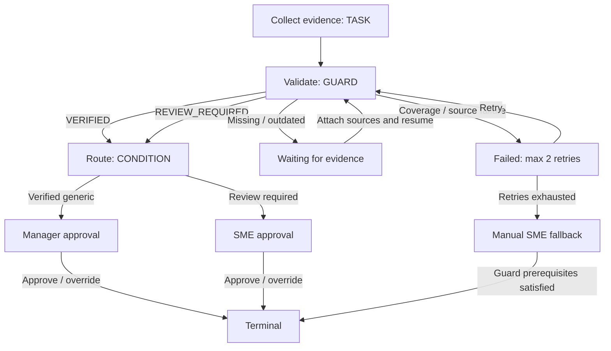

# Workflow Core — Fase 3

**Rekonsiliasi PRD v2:** model/API di dokumen ini tetap merupakan arsitektur internal. Produk memakai My Work, Progress, Reviews / Approvals, dan Activity. PRD v2 menggantikan PRD v1; Fase 4 belum dimulai.

## Batas dan arsitektur

Reliable Knowledge → Case → persistent workflow → task → human decision → audit.

Case bersifat domain-neutral. Type `general`, `operations`, `audit`, `regulatory_review`, dan `investment` hanya klasifikasi; tidak menjalankan comparison, remediation, atau analisis investasi. Fase 4 belum dimulai.

Service `cases.py` mengatur konteks dan akses; `workflows.py` menjalankan state machine; `workflow_views.py` membentuk proyeksi bertipe; `workflow_api.py` menyediakan REST. Tidak ada orchestrator eksternal atau visual builder.

## Model dan migrasi

Migrasi `0004_workflow_core.py` menambah `cases`, `case_evidence`, `workflow_definitions`, `workflow_runs`, `workflow_steps`, `step_attempts`, `tasks`, `approvals`, dan `action_receipts`. Constraint status dan unique relationship mencegah task ganda pada step dan workflow ganda pada Case.

Case menyimpan identity, type, description, owner/requester, status, revision, timestamp, original QuestionRun opsional, context QuestionRun, dan latest GuardEvaluation. Context run tersendiri memakai model QuestionRun existing agar penambahan evidence tidak mengubah saved answer asal. Context internal ini tidak ditampilkan pada Ask history/saved-Ask endpoint; pembacaan melalui Case API menjaga additional evidence requirements.

`CaseEvidence.item` memakai schema `EvidenceItem` existing. Required evidence hanya tersedia jika menunjuk chunk authorized/current/authority ≥4 yang benar-benar masuk konteks evaluasi. Tidak ada evidence system kedua atau evidence berupa teks yang dianggap cukup tanpa source.

GuardEvaluation tetap terkait QuestionRun. AuditEvent existing mencatat seluruh perubahan; tidak ada workflow audit table baru.

## State machine

Definisi `generic-review-v1`, versi `1.0`, disimpan saat seed dan disalin menjadi config snapshot pada WorkflowRun. Perubahan definisi harus memakai versi baru; tidak ada endpoint editor.



Case: OPEN, IN_PROGRESS, WAITING_FOR_EVIDENCE, WAITING_FOR_REVIEW, COMPLETED, CANCELLED.

Workflow: RUNNING, WAITING_FOR_EVIDENCE, WAITING_FOR_APPROVAL, FAILED, ESCALATED, COMPLETED, CANCELLED. Step: PENDING, ACTIVE, WAITING, FAILED, COMPLETED, SKIPPED, CANCELLED. Seluruh vocabulary didefinisikan pada `workflow_contracts.py`; frontend types dihasilkan, tidak menghitung status sendiri.

Completion task pertama menjalankan Guard, condition, dan pembentukan approval secara transaksional. Branch yang tidak terpilih menjadi SKIPPED saat completion. Material decision selalu memerlukan manusia independen; VERIFIED tidak otomatis menyelesaikan workflow.

## Task dan keputusan

Task: TODO → IN_PROGRESS → DONE; prototype juga menyediakan BLOCKED/CANCELLED. Owner Case mendapat task evidence dengan due date dua hari. Tidak ada scheduler, notification, atau SLA escalation otomatis. Completion boleh langsung dari TODO, lalu step berikutnya dijalankan.

Approval: PENDING → APPROVED / REJECTED / EVIDENCE_REQUESTED / ESCALATED / OVERRIDDEN. Histori request/decision tetap tersimpan. Decision Center menampilkan queue nyata dari database. Detail respons menyertakan case, workflow, evidence, sources, requester/reviewer, reason, dan tindakan yang diizinkan backend.

Request Evidence mewajibkan reason dan label. Backend menyimpan required EvidenceItem missing, menutup request lama, dan menempatkan workflow kembali pada Guard WAITING_FOR_EVIDENCE. Owner melampirkan current approved chunk ke requirement; Resume mengevaluasi Guard ulang dan membuat approval baru. Requirement keyword receipt exception existing tetap memerlukan policy yang benar, tidak dapat dipenuhi dengan sembarang label.

Approve pada REVIEW_REQUIRED mewajibkan reason. Keputusan manusia tidak mengubah reliability menjadi VERIFIED. Override hanya Governance, reason non-empty wajib, dan tetap tidak dapat melewati BLOCKED, OUTDATED, atau ACCESS_RESTRICTED. Reject membatalkan execution dan pending work; audit tetap ada.

## Guard dan izin

Guard existing diperluas dengan additional evidence bertipe. Semua check/status/coverage/version/conflict memakai service Fase 2. Evaluasi disimpan dan diperiksa ulang saat read/action. Citation memakai document/version/chunk existing; tidak ada salinan private excerpt pada audit.

Case dari Ask harus berasal dari saved run milik actor. ACCESS_RESTRICTED ditolak. BLOCKED memerlukan consent evidence-recovery eksplisit; tidak pernah otomatis membuat Case. Manual Case tanpa sumber boleh dibuat tetapi Guard tetap BLOCKED.

Creator/owner, reviewer yang benar-benar ditugaskan, dan Governance dapat membaca Case jika seluruh source context tetap authorized. Pemeriksaan source dilakukan sebelum chunk text/cached answer; revoked case tidak tampil pada list dan direct read memberi 404 aman. Attach memeriksa akses creator/owner juga.

| Operasi                         | Aturan prototype backend                                                  |
| ------------------------------- | ------------------------------------------------------------------------- |
| Create                          | Semua identitas aktif; context authorized                                 |
| Edit/start/advance/retry        | Creator/owner atau Governance                                             |
| Reassign owner                  | Manager/Governance, sebelum workflow dimulai                              |
| Start/complete task             | Assigned owner atau Governance                                            |
| Approve/reject/request evidence | Assigned reviewer atau Governance; creator/owner tidak boleh self-approve |
| Override                        | Governance independen, reason wajib, Guard prerequisites lulus            |
| Escalate workflow               | Creator/owner/Governance, reason wajib                                    |
| Escalate approval               | Authorized reviewer, reason wajib; higher authority Governance            |

Generic verified route ke Manager; conflict ke SME. Type investment memakai Finance, regulatory_review memakai Compliance, audit memakai SME untuk normal review. Jika role tidak mempunyai sumber atau independen reviewer tidak tersedia, fallback reviewer Governance yang authorized; jika tetap tidak tersedia, 409. Tidak ada entitlement produksi.

## Retry, fallback, escalation

Coverage/source integrity failure pada Guard step tercatat sebagai FAILED; tidak menghapus attempt sebelumnya. Retry hanya pada failed retryable step dan maksimal dua. Attempt menyimpan actor, outcome, reason, Guard ID, number, dan timestamp. Setelah maksimum, config mengarahkan ke manual SME review. Fallback tetap tidak mengizinkan approve terhadap prerequisite Guard yang gagal; reviewer dapat meminta evidence, reject, atau escalate.

Missing evidence/outdated merupakan waiting state, bukan loop retry teknis. Attach current replacement mengeluarkan historical references dokumen yang sama; histori audit/attempt tetap tersedia.

Escalation menyimpan actor/reason/time dan membuat request Governance; request lama menjadi ESCALATED. Task yang dieskalasikan tidak boleh dilanjutkan sebelum higher-authority review. Tidak ada email atau notification.

## Transaksi, konflik, idempotency

Mutasi mengunci row Case PostgreSQL dan metadata dokumen konteks; metadata publication/perubahan izin dan execution diserialkan. `expected_revision` wajib. Payload dari revision usang mendapat 409; task/approval/transition ganda ditolak.

`idempotency_key` opsional pada mutasi existing Case. Receipt unik per Case/actor/key menyimpan fingerprint operasi/payload. Retry dengan key/payload identik tidak membuat task, approval, atau audit transition baru; respons merupakan proyeksi Case terkini. Reuse key dengan payload berbeda memberi 409. Semua receipt/state/audit berada dalam satu transaksi. Creation Case belum mempunyai idempotency key; UI menahan submit berulang saat busy.

Row locking database diverifikasi melalui browser dengan request approve/reject bersamaan pada PostgreSQL. SQLite hanya untuk unit/API tests, bukan jaminan concurrency deployment.

## API

Endpoint memerlukan `X-User-Id`. Schema lengkap tersedia di `/docs`.

- POST/GET `/api/cases`; GET/PATCH `/api/cases/{id}`.
- POST `/api/cases/{id}/evidence` (`chunk_ids`, optional `requirement_key`).
- GET `/api/workflow-definitions`; POST `/api/workflows/{definition_id}/start` (`case_id`).
- GET `/api/workflow-runs`; GET `/api/workflow-runs/{id}`; POST `advance`, `retry`, `escalate` subpaths.
- GET `/api/tasks`; POST `/api/tasks/{id}/start` atau `/complete`.
- GET `/api/approvals`; GET `/api/approvals/{id}`; POST `approve`, `reject`, `request-evidence`, `escalate`, `override` subpaths.

Mutasi/read execution detail mengembalikan CaseView komprehensif, termasuk workflow, tasks, approvals, Guard/evidence/sources dan activity. Queue endpoints mengembalikan typed list. Seluruh mutasi selain create Case menerima expected_revision; optional idempotency_key/reason. Error 403 authority, 404 unavailable context, 409 stale/invalid transition, 422 form/prerequisites; tidak ada raw stack trace.

## Audit

AuditEvent entity_type=case/entity_id=Case ID mencatat case_created/updated/cancelled, evidence_added, answer_generated, guard_evaluated, workflow_started/advanced/completed, task_created/started/completed, step_failed, retry_requested, fallback_triggered, escalation_created, approval_requested/approved/rejected/superseded, evidence_requested, override_performed. Reason keputusan dicatat; excerpt tidak disalin ke audit. Guard juga mempertahankan event QuestionRun Fase 2.

Case Workspace menampilkan audit participant terkait Case, dengan source context diotorisasi ulang. `/api/audit` Fase 2 tetap own-actor; Governance module penuh belum dibuat. Proteksi append-only dan maintenance reset existing tetap berlaku.

## Demo dan reset

```powershell
npm.cmd run db:migrate
npm.cmd run db:seed
npm.cmd run demo:workflow
```

CLI demo opsional membuat tiga Case sintetis dan workflow pada task awal; berulang tidak menimpa execution existing. `db:reset -- --confirm-synthetic-data` menghapus data Fase 0–3, termasuk Case/workflow/decision/attempt/receipt/audit demo. Jalankan demo:workflow kembali jika membutuhkan tiga Case awal.

1. **A:** Employee membuka Demo A, complete task → Manager approve → completion. Alternatif: Ask annual leave → Request Review → Submit Request → My Work.
2. **B:** Demo B tanpa sumber → complete task → WAITING_FOR_EVIDENCE. Manager Request evidence dengan label approved leave policy. Employee Attach source evidence, pilih active Annual Leave Policy section dan requirement; Resume → Manager approve.
3. **C:** Demo C → complete task → SME menerima konflik 12 vs 6 bulan. Inspect sources, record reason → approve atau reject. Guard REVIEW_REQUIRED tetap terlihat.
4. Manager dapat escalate request ke Governance. Pilih Override; reason wajib. Skenario blocked/outdated tidak dapat dioverride.
5. Retry/fallback diuji dengan context extract yang tidak lagi matching; tidak ada tombol UI untuk memalsukan kegagalan. Histori attempt dan fallback dapat diperiksa pada timeline.

## UI dan 21st.dev

AnswerCard mempunyai tindakan kontekstual Request Review, Start Review, Request Exception, atau Provide Information. Submit Request memakai Case/start API existing. My Work menyajikan work item; Reviews hanya untuk reviewer; Progress dan Activity memakai bahasa pekerjaan. Tidak ada standalone Workflows, Cases, Decision Center atau placeholder masa depan pada navigasi. WorkflowTimeline/ApprovalPanel existing tetap digunakan dengan kontrak yang sama; ComparisonTable tersedia pada Fase 4 dan FinancialAnalysis tersedia pada Fase 5.

MCP mencari Activity Timeline, Cubby UI Timeline dan task checklist. Source Cubby UI terkunci kuota; tidak ada vendor component baru yang dipasang tanpa inspeksi. Primitive tabel Origin UI existing, Dialog, metadata, badge, disclosure, tokens, dan SourcePanel dipakai kembali. Detail pada UI_REFERENCES.md.

## Pengujian dan batasan

```powershell
npm.cmd run format:api
npm.cmd run lint:api
npm.cmd run format:check
npm.cmd run lint
npm.cmd run typecheck
node scripts/python.mjs scripts/generate-workflow.py --check
npm.cmd run test:api
npm.cmd run test:web
npm.cmd run test:e2e
npm.cmd run build
```

Hasil final ada di IMPLEMENTATION_STATUS.md. Jalankan backend PostgreSQL dan browser suites berurutan bila memakai database test yang sama.

Batasan: satu workflow per Case, konfigurasi code-defined, evidence berbasis approved source chunk (belum arbitrary operational attachment; semantic kesesuaian label evidence membutuhkan penilaian reviewer), reviewer prototype/mock identity, tidak ada scheduler/tool integration/notification, tidak ada WORM eksternal. State FAILED berasal dari check deterministik; belum ada tool runtime eksternal. Jenis Case tidak membawa fitur domain Fase 4/5. Guard extractive/conflict rules tetap terbatas seperti Fase 2.
